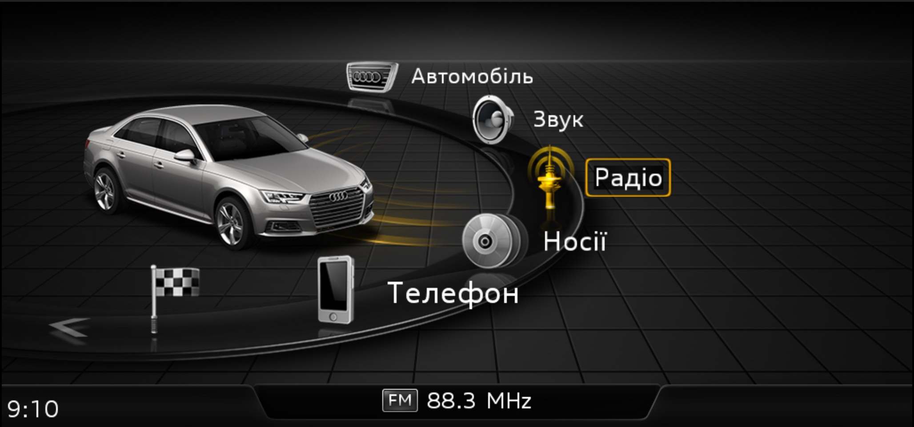
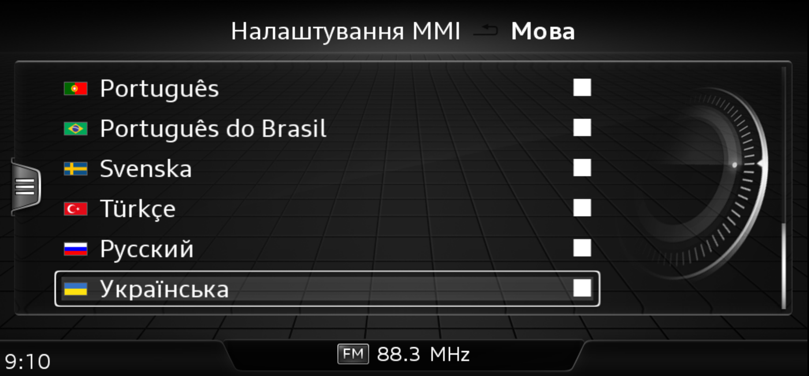
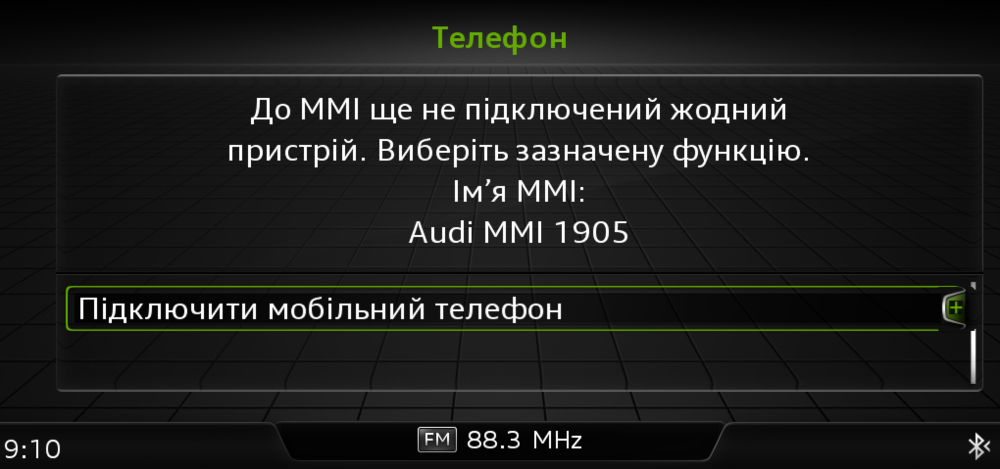
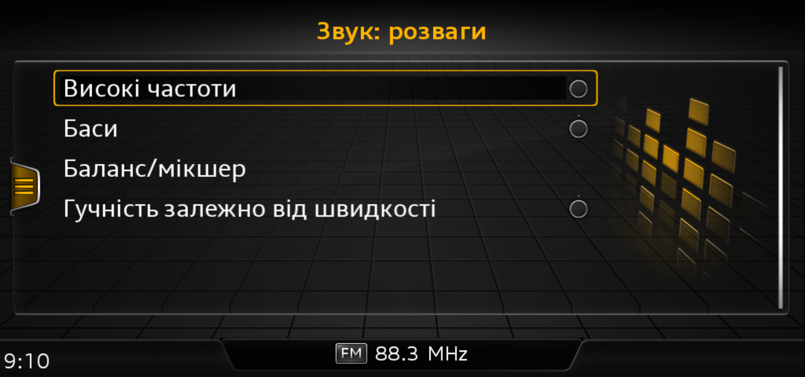
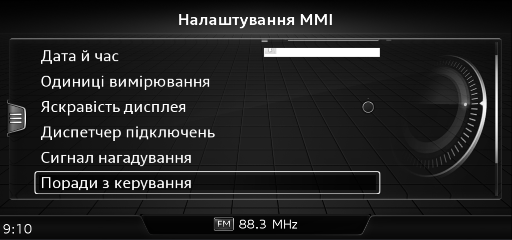

# 🇺🇦 Ukrainian localization for Audi MHI2 — A4 / A5 / Q5 / Q7

**MHI2_ER_AUG22_K3346 · MU1438 · G22 · EvoHigh**

[Українська](#українська) · [English](#english) · [Download / Завантажити](https://github.com/yety-ua/mhi2-ukrainian-localization/releases) · [Глибина / Coverage](docs/LOCALIZATION_DEPTH.md) · [A4 provenance](docs/A4_PROVENANCE.md)



## Українська

Локалізація для штатної прошивки **Audi MHI2 K3346 на A4, A5, Q5 та Q7**: українські тексти,
вибір мови з прапорцем, українська смуга клавіатури та встановлення з однієї
SD-карти через [M.I.B.](https://github.com/Mr-MIBonk/M.I.B._More-Incredible-Bash).
Пакет додає ресурси й параметризацію; повна прошивка не перепрошивається.

**Статус: preview для перевірки на автомобілі.** Структуру ресурсів та інсталятор
перевірено офлайн, українські екрани показані в емуляторі. Виконання інсталятора
на справжньому QNX, встановлення й відновлення на автомобілі ще не підтверджені.
Це не твердження про 100% перекладу кожного доступного екрана. Повний опис
реалізованих частин і залишкових питань — у [документі глибини](docs/LOCALIZATION_DEPTH.md).

### Що включено

- Українські таблиці **22 модулів**, збереження структури **15 400 штатних
  непорожніх слотів** і додаткова назва мови «Українська» — разом 15 401 слот.
- Вибір `uk_UA` у меню, український прапорець, конфігурація доступних мов і датасет `2D00`.
- **Клавіатура MMI:** смуга 33 українських літер `АБВГҐДЕЄЖЗИІЇЙКЛМНОПРСТУФХЦЧШЩЬЮЯ`,
  кирилиця за замовчуванням для української, без `Ё Ъ Ы Э`. Це смуга для ручки/тачпада, не QWERTY.
- Перевірка точної прошивки, контрольних сум, оригінальних ресурсів і CRC параметризації;
  резервні копії на SD та в голові; перевірка запису; окреме відновлення.
- Окремий необов'язковий компонент: **англійський** NAVI/TTS/SDS fallback.
  Українське голосове розпізнавання та український голос не додаються.

### Сумісність

| Параметр | Єдина ціль цього пакета |
| --- | --- |
| Моделі / платформа | Audi A4, A5, Q5, Q7 з наведеною нижче прошивкою / G22, MLB Evo |
| Firmware train | `MHI2_ER_AUG22_K3346` |
| MU | `1438` |
| HMI | `HMI_AU_MIB2_H_EU_G22_C6_190300`, `EvoHigh` |
| Носій | FAT32 SD-карта в **SD1** з повним M.I.B. |

Інші MHI2, Audi A3 `AU37x/P5089`, MHI2Q, MIB3 та інші MU не підтримуються.
Інсталятор звіряє реальний train/MU з EEPROM і точний хеш HMI. A3 була
додатковим джерелом перекладів за збігом тексту, але структура, ID, класи й
параметризація цільового пакета належать A4 K3346. [Докази походження](docs/A4_PROVENANCE.md).

Вихідні ресурси та емуляторні докази перевірені на базі A4 B9. Перелік моделей
стосується цієї самої прошивки, а не всіх MMI на A4/A5/Q5/Q7. Для іншої моделі
інсталятор також вимагає збігу оригінальних ресурсів і датасетів; при розбіжності
він зупиниться. Окремих автомобільних випробувань цих моделей поки немає.

### Скріншоти

Власник зробив ці знімки **лише екрана MMI** в емуляторі K3346 13.10.2026.
Вони показують мову інтерфейсу, а не перевірку фізичного автомобіля.
Вони передують дев'ятьом правкам лише в Connectivity; показані модулі не змінені.

| Вибір української мови / Language selection | Телефон / Phone |
| --- | --- |
|  |  |

| Звук / Sound | Налаштування MMI / MMI settings |
| --- | --- |
|  |  |

На окремих екранах емулятор неповністю відображає графічні віджети; це не
підтвердження такого самого дефекту на автомобілі. [Походження знімків](docs/screenshots.json).

### Підготовка SD-карти

1. Завантажте `mhi2-ukrainian-localization-k3346-v1.0.0-preview.1.zip` і `.sha256`
   з [Releases](https://github.com/yety-ua/mhi2-ukrainian-localization/releases).
   **GitHub Source code ZIP — це репозиторій, а не готовий корінь SD.**
2. M.I.B. має вже бути встановлений у голові; його повний дистрибутив має лежати
   в корені writable FAT32 SD-карти. Цей пакет не містить і не перевстановлює M.I.B.
3. Розпакуйте реліз на комп'ютері. Скопіюйте **`uk-localization/` у корінь SD**, а
   **`mod/custom.sh` у наявну папку `mod/`**. Не додавайте зовнішню папку з назвою архіву.
4. Якщо на SD уже є власний `mod/custom.sh`, спочатку збережіть його копію під іншою
   назвою. Новий entry point не запускає старі команди. Інші файли M.I.B. збережіть.

```text
SD1/
├── apps/                         повний наявний M.I.B.
├── config/                       наявний M.I.B.
├── esd/                          наявний M.I.B.
├── Launcher/                     наявний M.I.B.
├── mod/
│   └── custom.sh                 entry point із цього релізу
├── ...                           решта файлів M.I.B. збережена
└── uk-localization/
    ├── ACTION.txt                CHECK за замовчуванням
    ├── HMI.sha1
    ├── SHA1SUMS
    ├── package.json
    ├── scripts/
    ├── payload/
    ├── stock/
    ├── target/
    ├── logs/                     створюється під час запуску
    └── backups/                  створюється під час встановлення
```

### Перевірка і встановлення

1. Вставте підготовлену SD-карту в **перший слот голови — SD1**.
   Для першого запуску нічого редагувати не потрібно: у пакеті вже вибрано режим
   **перевірки**, який не встановлює локалізацію й не змінює мовні налаштування.
   Цей режим задано словом `CHECK` у файлі `uk-localization/ACTION.txt` на карті.
2. Відкрийте GEM → `m.i.b.` → `Advanced Settings` → `Run Custom Script`
   (можлива назва `Run /mod/custom.sh from m.i.b. SD`). Потрібні **`CHECK PASS` і код 0**.
   CHECK записує лише SD-лог і тимчасові файли; не змінює мовні ресурси чи параметризацію.
3. Перед першою автомобільною інсталяцією перевірте recovery telnet на порту 23,
   зробіть і перевірте повний резервний знімок M.I.B., підключіть стабільне зовнішнє
   живлення. Ноутбук не потрібний для перенесення пакета, але потрібен для незалежної
   recovery-перевірки першого випробування. Потрібно щонайменше 40000 KiB у `/mnt/app`.
4. На комп'ютері змініть єдиний рядок ACTION.txt на `INSTALL`. Знову запустіть той
   самий пункт GEM. Не виймайте SD, не натискайте Back, не запускайте інші операції M.I.B.
5. Інсталятор поверне ACTION.txt до CHECK, збереже оригінали в голові та на SD,
   встановить ресурси, запише `2D00` останнім і перевірить результат. `0x280` під час
   встановлення не змінюється. Невідомі попередні модифікації спричиняють зупинку.
6. Лише після **`SUCCESS: INSTALL` і коду 0** перезавантажте MMI вручну. Виберіть
   «Українська» в налаштуваннях мови. Перевірте меню, введення, діагностику та холодний
   запуск без SD. Очікується робота без карти після інсталяції; на авто це ще не доведено.

**Автоматичного перезавантаження немає.** За будь-якої помилки дивіться
`uk-localization/logs/run-*.log`. Якщо залишився `PENDING`, ресурси могли бути частково
змінені: не перезавантажуйте голову до відновлення. Запис упорядкований і журналюється,
але не є атомарною транзакцією при втраті живлення.
Зовнішнє повідомлення M.I.B. «execution finished» не означає успішної інсталяції;
орієнтуйтеся на SUCCESS/ERROR та код саме цього пакета.

### Дії ACTION.txt

| Значення | Дія |
| --- | --- |
| `CHECK` | Перевірка без зміни ресурсів/параметризації |
| `INSTALL` | Встановлення українського інтерфейсу й клавіатури |
| `VOICE_INSTALL` | Окреме встановлення англійського голосового fallback після перевірки UI |
| `VOICE_RESTORE` | Прибрати лише керований голосовий hook |
| `RESTORE` | Відновити оригінальні ресурси та датасети |

Для VOICE_INSTALL потрібні англійські ресурси в голові. Після успіху — окремий ручний
reboot і перемикання з української на іншу мову й назад. Це не український голос.

### Відновлення

Запишіть `RESTORE` у ACTION.txt і запустіть той самий пункт GEM. Пакет відновлює
оригінальні ZIP/config/LUT, `2D00/0x280`, прибирає лише свої початково відсутні
hooks/прапорець і перевіряє запис. Бекапи та логи зберігаються; після відновлення
можна повторити інсталяцію з тією самою базою.

Якщо HMI/GEM не запускається, через заздалегідь перевірений telnet до **MMX** запустіть
внутрішню копію (скрипти й потрібні інструменти M.I.B. скопійовані в голову):

```sh
/bin/sh /mnt/app/root/uk-localization/recovery/scripts/localization.sh RESTORE
```

Дочекайтеся SUCCESS: RESTORE і коду 0 перед перезавантаженням. Пошкоджене поточне
значення persistence не блокує повернення повної перевіреної бази. Якщо COMPLETE
відсутній або пошкоджений — зупиніться, не використовуйте force і не видаляйте стан.
Після аварії shell може лишитися `/tmp/uk-localization.lock`; не видаляйте його,
доки не підтверджено відсутність активної операції. Відкат мовних ресурсів не замінює
recovery голови, яка взагалі не може завантажити QNX.

### Глибина, походження та обмеження

Читайте [огляд глибини](docs/LOCALIZATION_DEPTH.md), [перевірку A4/A3](docs/A4_PROVENANCE.md)
і [редакційні правки Connectivity](docs/connectivity-review-2026-10-13.json).
Клавіатура включена; рукописний рушій лишається `ru_RU`, а повне розпізнавання
українських штрихів не доведене. Навігаційні пошук/маршрути та Virtual Cockpit
перевіряються окремо. VC0313 не отримає українські ресурси з цього пакета.
Деякі команди, бренди, діагностичні/регіональні тексти залишаються англійською;
не всі редакційні кандидати означають відсутній переклад.

### Українська у Virtual Cockpit: що очікувати

**Українська в MMI не означає автоматично українську в кокпіті.** Панель приладів
має власні мовні ресурси. Цей SD-пакет їх не встановлює та VC не перепрошиває.

| Автомобілі / гілка VC | Версія VC | Попередній результат |
| --- | --- | --- |
| A4/A5/Q5, AU491 | **0313** | **Українську не підхопить:** штатна версія відхиляє код мови 43 |
| A4/A5/Q5, AU491 | **0379** | **Мовна підтримка є:** код 43 і власні українські ресурси підтверджені; показ на авто перевіряється окремо |
| Q7, AU736 | **0310** | Підтримку української **ще не встановлено** |
| Q7, AU736 | **0378** | Підтримку української **ще не встановлено** |
| Q7, AU736 | **0416** | Підтримку української **ще не встановлено** |

**H15 не є автоматичною забороною для 0379**, але результати роботи компаса після
оновлення суперечливі. Вища H-ревізія теж не є універсальною гарантією сумісності.
Не вибирайте прошивку лише за номером версії або назвою моделі.

[Повне дослідження VC: версії, H15/H17/H18/H19, компас, Q7/TPMS та джерела](docs/VC_COMPATIBILITY.md).
Для підбору потрібна ідентичність блока 17 (панель приладів): номери HW/SW,
H-ревізія, поточна версія ПЗ, модельний рік і регіон. «Не встановлено» в таблиці
означає відсутність достатнього доказу, а не доведену відсутність української.

## English

A Ukrainian localization overlay for **Audi MHI2 K3346 on A4, A5, Q5 and Q7**,
installed from a single FAT32 SD1 card through M.I.B. It includes Ukrainian UI
tables, language selection, the Ukrainian alphabet band and reversible resource
installation with language parameterization. No full firmware/IFS update is performed.

**Status: preview for vehicle validation.** Host simulations and structural checks
pass, and Ukrainian screens run in the K3346 emulator. The SD installer has not
been executed on the physical QNX head unit; vehicle installation, restoration,
cold-boot persistence and full UI/speech behavior are not yet verified. This is
not a claim of complete translation of every reachable screen.

### Coverage and exact target

- **22 target modules; 15,400 original nonempty slots plus one Ukrainian language-name slot.**
- `uk_UA` language menu entry, flag, builtin config and reviewed `2D00` parameterization.
- MMI rotary/touch **alphabet band with all 33 Ukrainian letters**, including `Ґ Є І Ї`,
  Cyrillic default and no `Ё Ъ Ы Э`. It is an alphabet band, not a QWERTY layout.
- Exact train/MU/HMI verification, checksums, persistence CRCs, baseline copies on
  SD and the unit, read-back and independent restoration.
- Optional **English** NAVI/TTS/SDS routing in a separate install/reboot cycle;
  no Ukrainian speech recognition or Ukrainian voice assets.

Only `MHI2_ER_AUG22_K3346`, MU1438, G22/MLB Evo,
`HMI_AU_MIB2_H_EU_G22_C6_190300` / EvoHigh are supported.
A3 AU37x/P5089, MHI2Q, MIB3 and different firmware/MU versions are rejected.
A3 supplied additional dictionary translations matched by the **A4 source text**;
its table IDs, layout, classes and vehicle coding were not transplanted.
[Provenance evidence and limitations](docs/A4_PROVENANCE.md).

Source resources and emulator evidence were checked against the A4 B9 baseline.
The model list applies to this exact firmware, not every MMI fitted to these models.
Other models must also match the reviewed stock resources and datasets; the installer
stops on a mismatch. Separate physical-vehicle trials for these models are pending.

### Screenshots

The gallery above contains owner-captured, screen-only K3346 emulator screenshots
from 2026-10-13: main menu, language selection, phone, sound and MMI settings.
They are UI evidence, not vehicle acceptance. They precede the nine Connectivity-only
publication text fixes; none of the shown modules changed. Some emulated widget
rendering is incomplete. [Capture provenance](docs/screenshots.json).

### Prepare the SD card

1. Download the release ZIP and its `.sha256` from
   [Releases](https://github.com/yety-ua/mhi2-ukrainian-localization/releases).
   GitHub's Source code ZIP is the repository, not a ready SD-root overlay.
2. Use a writable FAT32 card in **SD1**, with the full existing M.I.B. distribution
   at its root. M.I.B. must already be installed on the unit; this overlay does not
   include or reinstall M.I.B.
3. Extract the release on the computer. Copy **`uk-localization/` to the SD root**
   and **`mod/custom.sh` into the existing `mod/` directory**. Do not add an enclosing
   release-name directory. Preserve the remaining M.I.B. files.
4. If a custom `mod/custom.sh` exists, save it under another name before replacement.
   The new entry point does not chain existing commands. The SD tree is shown above.

### Check and install

1. Insert the prepared SD card into **the head unit's first SD slot — SD1**.
   No file editing is needed for the first run: the package already selects
   **check mode**, which does not install the localization or change language settings.
   This mode is selected by the word `CHECK` in `uk-localization/ACTION.txt` on the card.
2. Open GEM → `m.i.b.` → `Advanced Settings` → `Run Custom Script` (possibly labelled
   `Run /mod/custom.sh from m.i.b. SD`). Require **CHECK PASS and exit code 0**.
   CHECK writes only the SD log and temporary files; no app remount/resource/persistence write.
3. Before the first vehicle trial, confirm recovery telnet on port 23, make/verify
   the complete M.I.B. backup and connect stable external power. Installation transport
   uses only SD, but the first trial still needs independent laptop recovery verification.
   At least 40000 KiB free in `/mnt/app` is required.
4. On the computer, change ACTION.txt to `INSTALL` and run the same GEM item. Do not
   remove SD, press Back or run other M.I.B. backup/reboot/flash operations concurrently.
5. The action resets to CHECK before writing. Baselines are stored on SD and the unit;
   resources are installed before 2D00 and verified by read-back. 0x280 is unchanged
   during installation. Unknown existing modifications cause an abort.
6. Only after **SUCCESS: INSTALL and exit code 0**, reboot manually and select Ukrainian
   under Settings > Language. Check menus/input/diagnostics and a cold boot without SD.
   Operation without SD is intended after installation but remains a vehicle test.

There is **no automatic reboot**. For errors, inspect `uk-localization/logs/run-*.log`.
PENDING indicates an interrupted operation: do not reboot until restoration has been
checked. Writes are ordered/journalled, not a power-loss-atomic transaction. The outer
M.I.B. “execution finished” message is unconditional; use this package's SUCCESS/ERROR
and exit code. Actions are CHECK, INSTALL, VOICE_INSTALL, VOICE_RESTORE and RESTORE.

### English voice fallback

After validating UI, set ACTION.txt to `VOICE_INSTALL` and run the same GEM item.
After success, reboot manually and switch away from Ukrainian and back. English
speech resources must exist on the unit. Verify actual microphone/audio behavior;
this is not Ukrainian speech support. `VOICE_RESTORE` removes only this managed hook.

### Restore and recover

Set ACTION.txt to `RESTORE` and use the same GEM item. It restores baseline
ZIP/config/LUT and 2D00/0x280, removes only its originally absent hooks/flag, checks
read-back and keeps backups/logs. Reinstallation retains the original baseline.

If HMI/GEM cannot start, use the previously verified telnet connection to **MMX**:

```sh
/bin/sh /mnt/app/root/uk-localization/recovery/scripts/localization.sh RESTORE
```

The internal package includes required M.I.B. tools, so this recovery route does not
require the SD card. Require SUCCESS: RESTORE and exit code 0 before rebooting.
An unreadable current persistence value does not prevent restoring a trusted complete
baseline. Missing/damaged COMPLETE requires investigation; do not force or remove state.
A crashed shell can leave `/tmp/uk-localization.lock`; inspect active operations before
removing it. Resource rollback is not boot recovery for a unit unable to run QNX.

### Localization depth and limits

[Coverage review](docs/LOCALIZATION_DEPTH.md) describes keyboard, handwriting, fonts,
navigation, voice, VC and remaining editorial work. The native handwriting engine
remains ru_RU; alphabet display does not prove all Ukrainian stroke recognition.
VC0313 receives no new Ukrainian resource bank from this package. Brands, numbers,
supported English commands, diagnostics and region-specific strings are not all
expected to be Cyrillic; candidate counts are not a translation-completeness percentage.

### Ukrainian in Virtual Cockpit

**Ukrainian MMI does not automatically make the cluster Ukrainian.** VC uses its
own language resources; this SD overlay never installs or flashes VC firmware.

| Models / VC family | VC software | Preliminary result |
| --- | --- | --- |
| A4/A5/Q5, AU491 | **0313** | **No native Ukrainian from this package:** stock VC rejects language code 43 |
| A4/A5/Q5, AU491 | **0379** | **Language support confirmed in protocol/resources:** physical rendering and update eligibility are separate |
| Q7, AU736 | **0310** | Ukrainian support **undetermined** |
| Q7, AU736 | **0378** | Ukrainian support **undetermined** |
| Q7, AU736 | **0416** | Ukrainian support **undetermined** |

**H15 is not a proven blanket blocker for 0379**, but compass results after updates
conflict. A higher H revision is not universal compatibility approval either.
[Full sourced VC research](docs/VC_COMPATIBILITY.md) separates native language support,
hardware/update eligibility, compass and Q7/TPMS behavior. Use complete module-17
HW/SW identifiers, H revision, software, model year and region. Undetermined means
insufficient evidence, not proven absence of Ukrainian.

### Development / Розробка

**Технічна примітка щодо ACTION.txt:** готовий файл уже має потрібний формат.
Якщо редагуєте його для зміни режиму, зберігайте лише одне слово дії, без пробілів,
у ASCII або UTF-8 без BOM, з переносом LF. Це вимога скрипта, не окрема дія перед CHECK.

**Technical note on ACTION.txt:** the supplied file already has the required format.
When editing it to change modes, retain a single action word without whitespace,
ASCII or UTF-8 without BOM, and LF line endings. No format conversion is needed before CHECK.

```sh
python3 -m unittest discover -s tests -v
python3 tools/audit_resources.py --output docs/resource-audit.json
sh -n sd-card/mod/custom.sh sd-card/uk-localization/scripts/localization.sh
python3 tools/package_release.py
```

The packaging tool refuses existing output; use `--output` with a fresh filename.
Runtime checks use M.I.B.'s SHA-1 utility; package metadata and the release sidecar
also use SHA-256. Checksums detect transfer corruption, not authenticity signatures.
The released hook is the production hook, never the emulator timeout override.

### References / Джерела

[M.I.B.](https://github.com/Mr-MIBonk/M.I.B._More-Incredible-Bash),
[GEM custom entry](https://github.com/Mr-MIBonk/M.I.B._More-Incredible-Bash/blob/0e041895a1ce36da4cb0835437d48aa5dbbf262a/esd/scripts/custom.sh),
[GEM menu](https://github.com/Mr-MIBonk/M.I.B._More-Incredible-Bash/blob/0e041895a1ce36da4cb0835437d48aa5dbbf262a/esd/Launcher-sda0.esd),
[tools/node routing](https://github.com/Mr-MIBonk/M.I.B._More-Incredible-Bash/blob/0e041895a1ce36da4cb0835437d48aa5dbbf262a/config/GLOBALS),
[language parameterization](https://github.com/Mr-MIBonk/M.I.B._More-Incredible-Bash/blob/0e041895a1ce36da4cb0835437d48aa5dbbf262a/apps/setlang).

This is an independent localization project. Firmware-derived resources retain
their existing third-party provenance; no Audi approval/signature is implied.
